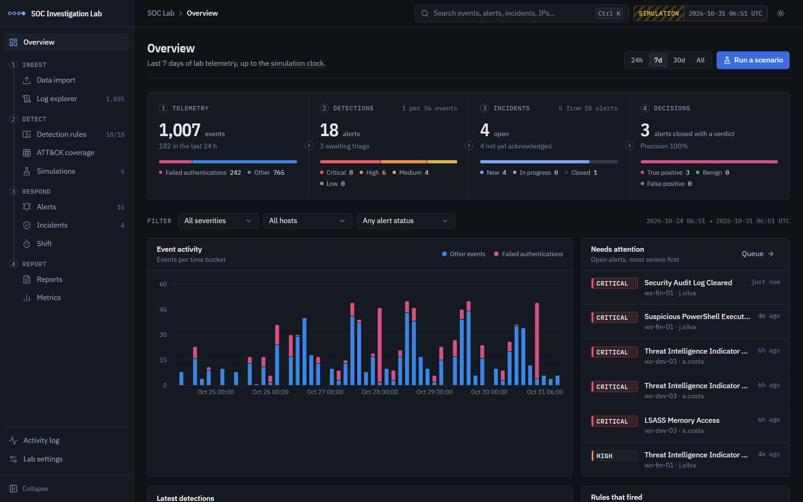
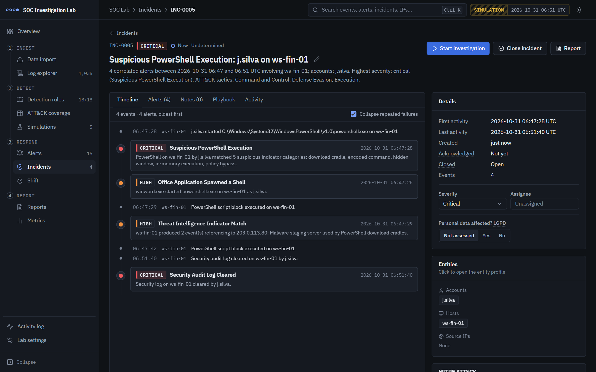
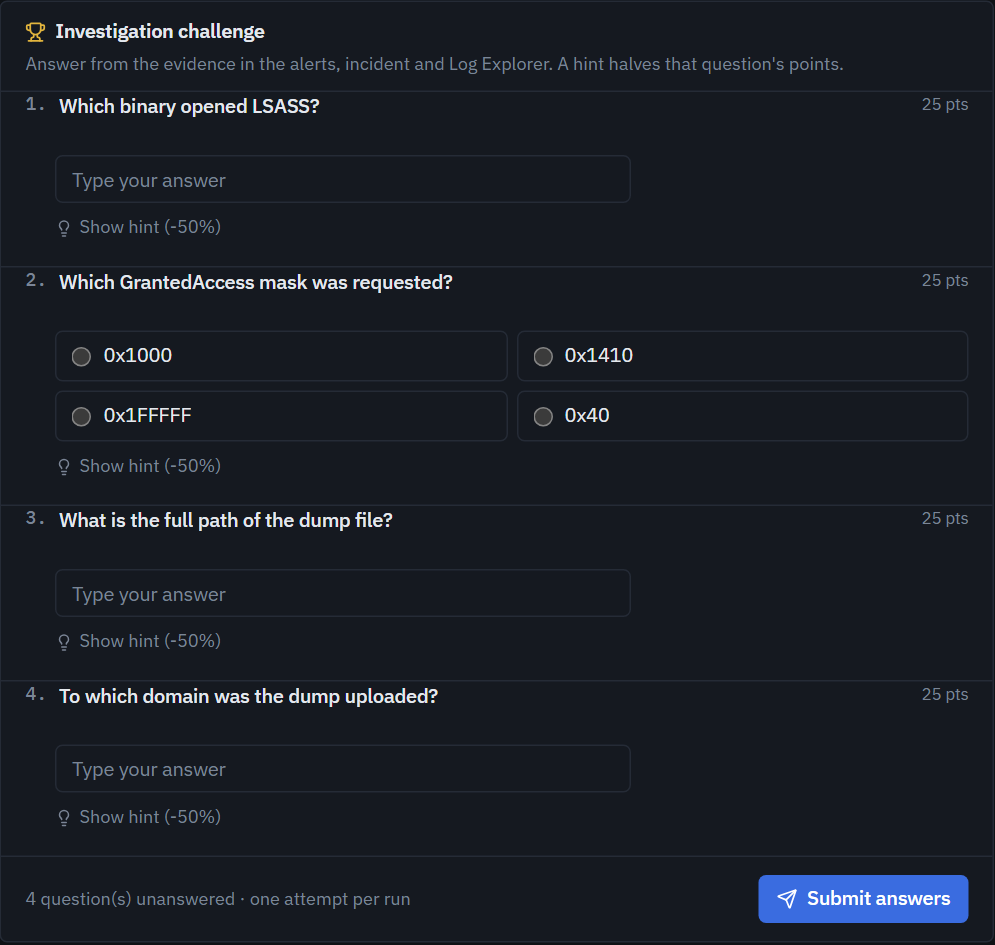
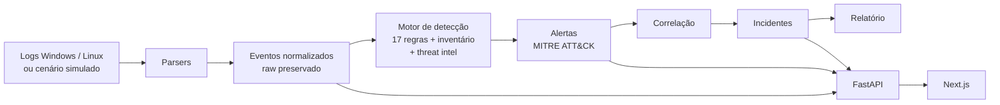

# SOC Investigation Lab

**O simulador de SOC em que você investiga o ataque e conserta a detecção.**

Plataforma educacional que simula a rotina de um analista SOC N1/N2: logs Windows, Linux e de aplicação são normalizados, um motor
de detecção em Python gera alertas mapeados ao MITRE ATT&CK, alertas são correlacionados em incidentes e cada investigação termina
em uma decisão documentada e em um relatório técnico.

### O que o diferencia

A maioria dos laboratórios de SOC para estudo para na investigação: você responde perguntas sobre um ataque pronto. Aqui o ciclo
fecha do lado da engenharia de detecção (*purple team*):

1. **Teste de regressão de detecção** - antes de salvar um ajuste de regra, o lab reexecuta *todos* os cenários com a regra atual e
   com a proposta e mostra o antes/depois: quantos ataques continuam detectados, quanto ruído saiu e qual cenário quebrou. É o
   "rodar a suíte de testes antes do merge" aplicado a regras de SIEM.
2. **Modo plantão** - uma fila cronometrada que mistura ataques reais, atividade autorizada e falsos positivos. Cada alerta exige
   veredito e justificativa; a nota pune o ataque fechado como ruído muito mais do que a escalada desnecessária. Treina o que derruba
   SOCs de verdade: **fadiga de alertas**.
3. **Regras Sigma escritas por você** - escreva ou cole Sigma (incluindo correlações `event_count`/`value_count`), valide com
   *dry-run* nos eventos do lab e coloque no motor ao lado das regras nativas. A regra entra no teste de regressão e exporta de volta.
4. **Contexto brasileiro** - golpe de **tomada de conta no internet banking com PIX** (regra LAB-018 sobre logs de aplicação), o
   caso benigno de troca de celular verificada pela central, e relatório com **prazos de comunicação à ANPD (LGPD)**: 3 dias úteis,
   conforme a Resolução CD/ANPD nº 15/2024.
5. **Cenários a partir de logs reais** - selecione eventos com uma consulta no Log Explorer, anonimize contas, hosts e IPs e salve
   como cenário reexecutável com gabarito (o motor calcula as detecções esperadas). Exporte em JSON para compartilhar com a turma ou
   o time.

> **Simulation Mode** - todos os dados são sintéticos (empresa fictícia *Lab Corp*, IPs das faixas de documentação RFC 5737).
> Nenhum serviço externo, conta ou chave de API é necessário.

**Princípio do projeto:** mostrar, de ponta a ponta, como *logs viram alertas, alertas viram investigações e investigações viram
decisões documentadas*.



<table>
  <tr>
    <td></td>
    <td></td>
  </tr>
  <tr>
    <td align="center">Teste de regressão: o ajuste tira ruído, mas perde um ataque</td>
    <td align="center">Modo plantão: ataques, ruído e o relógio correndo</td>
  </tr>
  <tr>
    <td></td>
    <td></td>
  </tr>
  <tr>
    <td align="center">Investigação do incidente: timeline, entidades, ATT&amp;CK</td>
    <td align="center">Log Explorer com linguagem de consulta e agregações</td>
  </tr>
  <tr>
    <td></td>
    <td></td>
  </tr>
  <tr>
    <td align="center">Modo desafio: perguntas verificadas e pontuação</td>
    <td align="center">Regras com tuning, backtest e exportação Sigma</td>
  </tr>
</table>

---

## Download e instalação (app desktop)

O SOC Investigation Lab também é distribuído como **aplicativo desktop**: não precisa de Python, Node.js, Docker nem internet.
Baixe o instalador na página **Releases** do repositório:

| Sistema | Arquivo | Como instalar |
|---|---|---|
| Windows 10/11 (64 bits) | `SOC-Investigation-Lab-Setup-<versão>.exe` | Execute o instalador (instalação por usuário, sem precisar de administrador). Atalhos no Menu Iniciar e na Área de Trabalho. |
| Linux (Ubuntu, Debian, Mint...) | `SOC-Investigation-Lab-<versão>-amd64.deb` | `sudo apt install ./SOC-Investigation-Lab-*.deb` e abra pelo menu de aplicativos. |
| Linux (qualquer distro) | `SOC-Investigation-Lab-<versão>-x86_64.AppImage` | `chmod +x SOC-Investigation-Lab-*.AppImage` e execute. |

Observações:

* Os instaladores não são assinados digitalmente; no Windows o SmartScreen pode exibir "O Windows protegeu o computador":
  clique em **Mais informações → Executar assim mesmo**.
* No Ubuntu 24.04+, se o AppImage não abrir por causa do sandbox do Chromium, prefira o `.deb` ou execute com `--no-sandbox`.
* Os dados do laboratório ficam na pasta do usuário (Windows: `%APPDATA%\SOC Investigation Lab`; Linux:
  `~/.config/SOC Investigation Lab`). O menu **File → Open data folder** abre essa pasta, e **Lab Settings → Reset lab**
  restaura o estado inicial.
* O servidor interno escuta apenas em `127.0.0.1`; nada é exposto na rede.

## O que dá para fazer

| Módulo | Destaques |
|---|---|
| **Dashboard SOC** | KPIs, atividade por período, severidade, regras mais acionadas, hosts e IPs de origem, atividade da investigação. Filtros por período, severidade, host e status. Tudo calculado pelo backend. |
| **Log Explorer** | Filtros combináveis (usuário, IP, host, origem, tipo, resultado, nível, dataset, intervalo UTC) **ou linguagem de consulta** no estilo KQL/SPL (`outcome:failure host:bastion-01 \| stats count by source_ip \| head 10`) com drill-down a partir das agregações. Visão normalizada/bruta, detalhe completo do evento e exportação CSV/JSON. |
| **Importação de logs** | Windows (JSON/NDJSON, incluindo **Sysmon** 1/3/10/11/22), Linux `auth.log` (syslog clássico e RFC 3339) e formato normalizado. Validação (dry run) antes de gravar, erros por linha, deduplicação por hash, fuso/ano configuráveis. |
| **Motor de detecção** | 18 regras nativas testadas (força bruta SSH/Windows, password spraying, login após força bruta, logon privilegiado fora do horário, root via SSH, criação de conta, grupo privilegiado, PowerShell suspeito, limpeza de log, tarefa agendada, serviço novo, movimento lateral, abuso de sudo, **acesso à memória do LSASS**, **Office abrindo shell**, **correspondência com threat intel** e **tomada de conta com PIX**). Ajuste de limiares com **backtest**, **teste de regressão** sobre todos os cenários, **regras Sigma próprias** e **exportação Sigma** (correlações Sigma v2 para os limiares). |
| **Threat intelligence** | Feed local e offline de indicadores (IP, domínio, URL, SHA256) consultado pelo motor; cada correspondência vira alerta com a severidade e a confiança do indicador. |
| **Simulações** | 11 cenários (8 ataques, 3 de ruído: manutenção autorizada, troca de celular verificada e senha esquecida) que geram logs brutos, passam pelos parsers reais e validam se as regras esperadas dispararam. Cenários próprios a partir de logs importados, com anonimização, exportação e importação em JSON. |
| **Modo plantão** | Fila cronometrada com ataques e ruído misturados; veredito (malicioso, benigno, falso positivo) e justificativa por alerta; nota por acurácia, SLA por severidade e qualidade da nota; debriefing com a verdade de cada alerta. |
| **Modo desafio** | Cada execução de cenário traz perguntas de investigação com resposta verificada no servidor (por exemplo, qual conta foi comprometida ou qual máscara de acesso foi pedida ao LSASS). Dicas custam metade dos pontos; o gabarito e as explicações aparecem só depois do envio. |
| **Alertas e incidentes** | Fila de triagem, indícios de falso positivo, correlação automática, timeline, entidades (usuário/host/IP com perfil), notas, playbook de resposta, classificação obrigatória para encerrar. |
| **MITRE ATT&CK** | Matriz de cobertura: técnicas cobertas por regra, técnicas observadas em alertas e lacunas. |
| **Relatórios** | Resumo executivo, escopo, detecções, ATT&CK, timeline, IOCs, evidências brutas, recomendações, **avaliação LGPD com prazos ANPD** e notas. Exporta Markdown/JSON e imprime em PDF. |
| **Métricas** | Precisão, taxa de falso positivo, MTTD, MTTA, MTTR, desempenho por regra, cobertura dos cenários, pontuação nos desafios, histórico de plantões e último teste de regressão. |

## Arquitetura



Detalhes em [docs/ARCHITECTURE.md](docs/ARCHITECTURE.md), o sistema visual em [docs/DESIGN-SYSTEM.md](docs/DESIGN-SYSTEM.md) e a documentação de cada regra em
[docs/DETECTION_RULES.md](docs/DETECTION_RULES.md).

## Stack

* **Backend:** Python 3.12, FastAPI, Pydantic v2, SQLite, PyYAML (Sigma), Pytest, Ruff. API REST documentada em OpenAPI (`/docs`).
* **Frontend:** Next.js 15 (App Router), React 19, TypeScript, Tailwind CSS 4, componentes no estilo shadcn/ui sobre Radix,
  IBM Plex (Sans, Condensed, Mono), Lucide, Recharts, Motion, SWR. Testes ponta a ponta com Playwright.
* **Persistência:** SQLite (padrão) com gravação incremental em transações e WAL, ou arquivos JSON com escrita atômica
  (`SOCLAB_STORAGE_BACKEND=json`). Estado em JSON de versões anteriores é migrado automaticamente; bancos corrompidos são
  colocados em quarentena.
* **Infra:** Docker, Docker Compose, GitHub Actions.
* **Desktop:** Electron + PyInstaller, instaladores NSIS (Windows), AppImage e .deb (Linux).

## Como executar

### Com Docker

```bash
cp .env.example .env
docker compose up --build
```

Acesse <http://localhost:3000> (API em <http://localhost:8000/docs>).

### Localmente

Requisitos: Python 3.12+ e Node.js 20+.

```bash
cd backend
python -m venv .venv
.venv/bin/pip install -r requirements-dev.txt          # Windows: .venv\Scripts\pip
.venv/bin/uvicorn app.main:app --reload --port 8000
```

Em outro terminal:

```bash
cd frontend
npm install
npm run dev
```

### Gerar os instaladores desktop

O app desktop é um shell **Electron** que inicia o backend empacotado com **PyInstaller**; o backend serve a interface
Next.js exportada como arquivos estáticos (uma única origem em `127.0.0.1`).

```bash
cd desktop
npm install
npm run dist          # gera o instalador do sistema atual em desktop/release/
```

O PyInstaller não faz compilação cruzada: o `.exe` é gerado no Windows e o `.AppImage`/`.deb` no Linux. O workflow
[`.github/workflows/release.yml`](.github/workflows/release.yml) faz os dois em paralelo e publica uma Release quando uma tag
`v*` é enviada:

```bash
git tag v1.0.0
git push origin v1.0.0
```

Para desenvolver o shell sem empacotar: exporte a interface (`NEXT_OUTPUT=export npx next build` em `frontend/`) e rode
`npm start` em `desktop/` - ele usa o Python do `backend/.venv`.

Na primeira execução o backend carrega o dataset base (uma semana de atividade normal + duas detecções orgânicas) e roda o
motor de detecção. Para voltar ao estado inicial use **Lab Settings → Reset lab**.

## Testes e qualidade

```bash
cd backend && .venv/bin/pytest            # 174 testes: parsers, regras, cenários, desafios, consultas, Sigma, regressão, plantão, SQLite e API
cd backend && .venv/bin/ruff check .
cd frontend && npm run lint && npm run typecheck && npm run build
cd frontend && NEXT_OUTPUT=export npm run build:export && npx playwright install chromium && npm run test:e2e
```

Os testes Playwright (`frontend/e2e/`) sobem o lab do zero como o app desktop e percorrem o fluxo do analista: dashboard,
simulação, incidente encerrado com justificativa, relatório, modo desafio, linguagem de consulta, importação com erros, teste de
regressão reprovando um ajuste, regra Sigma própria, plantão pontuado e cenário criado a partir de uma consulta.
As capturas de tela do README são regeneradas com `node scripts/screenshots.mjs`.

`tests/test_scenarios.py` funciona como uma validação de detecção: cada cenário, com duas sementes diferentes, precisa disparar
**exatamente** as regras para as quais foi desenhado, e o conjunto de cenários precisa cobrir todas as regras.

## Roteiro de demonstração (5 a 8 minutos)

O roteiro curto que mostra o diferencial (3 minutos):

* **Detection rules → LAB-002** - suba o limiar de 6 para 15 e clique em *Regression test*: o ruído do cenário de senha esquecida
  some, mas o teste **reprova** porque o *password spraying* deixa de ser detectado. Volte o valor e escreva uma regra Sigma que
  resolva o falso positivo sem perder o ataque.
* **Shift** - comece um plantão de 10 minutos e mostre o debriefing: o ataque fechado como ruído zera a pontuação daquele alerta.
* **Simulations → Internet-banking account takeover and PIX fraud** - investigue, marque *dados pessoais afetados* no incidente e
  mostre no relatório o prazo da ANPD.

Roteiro completo:

1. **Dashboard** - explique o *Simulation Mode*, o relógio simulado e os indicadores.
2. **Simulations → "Malicious macro, PowerShell download cradle"** - rode o cenário e mostre o pipeline
   *logs brutos → eventos → alertas → incidente* e a validação das regras esperadas.
3. **Incidente** - percorra a timeline, abra o evento bruto, veja o comando PowerShell decodificado, consulte o perfil do usuário
   e do host, registre uma nota e encerre como *true positive* com a justificativa.
4. **Relatório** - mostre IOCs extraídos, mapeamento ATT&CK e exporte em Markdown/PDF.
5. **Modo desafio** - rode *LSASS credential dumping (Sysmon)* e responda às perguntas usando o Log Explorer.
6. **Linguagem de consulta** - `outcome:failure | stats count by source_ip, hostname` e clique numa linha para o drill-down.
7. **Falso positivo** - rode *After-hours maintenance*, abra o alerta, mostre o indício "Inside approved change CHG-xxxx" e feche
   como benigno.
8. **Detection Rules** - altere o limiar do LAB-001, rode o backtest, abra a aba *Sigma rule* e discuta o equilíbrio entre ruído e cobertura.
9. **Data Import** - importe `samples/malformed_sample.log` e mostre os erros por linha; importe o mesmo arquivo de novo e mostre a
   deduplicação.

## Arquivos de exemplo

Em [`samples/`](samples) (também disponíveis para download na tela de importação):

| Arquivo | Conteúdo |
|---|---|
| `windows_security_sample.json` | Rajada de 4625 seguida de 4624 a partir de IP externo (dispara LAB-002 e LAB-004) |
| `linux_auth_sample.log` | Força bruta SSH em syslog clássico + tentativa de sudo negada (use ano 2026, fuso UTC) |
| `normalized_sample.json` | Eventos no esquema interno, com um registro inválido proposital |
| `sysmon_sample.json` | Sysmon: acesso ao LSASS por um binário suspeito (LAB-015) e por um antivírus (ignorado), DNS para domínio de phishing (LAB-016) |
| `malformed_sample.log` | Linhas válidas misturadas com conteúdo inválido para demonstrar o relatório de erros |

## Estrutura

```
backend/
  app/
    api/          rotas FastAPI
    detection/    regras, motor, inventário, catálogo MITRE
    models/       modelos Pydantic (contrato da API e esquema persistido)
    parsers/      Windows JSON, Linux auth.log, normalizado
    services/     orquestração, consultas, analytics, relatórios, ingestão
    simulation/   cenários e gerador do baseline
    storage/      persistência JSON atômica e repositórios
  data/           seed, cenários, inventário, ATT&CK
  tests/
frontend/
  src/app/        páginas (dashboard, alerts, incidents, events, rules, mitre, simulations, reports, metrics, import, settings)
  src/components/ shell, componentes de UI e de investigação
desktop/          app Electron (main.js), script de build dos instaladores e ícone
docs/             arquitetura e regras de detecção
samples/          arquivos para importação
```

## Decisões técnicas

* **IDs determinísticos** - eventos usam `sha256(origem + raw)`; alertas usam `regra | chave | primeiro evento`. Reimportar ou
  reexecutar a detecção nunca duplica dados e preserva o trabalho do analista.
* **Simulação pelo caminho real** - cenários geram texto bruto e passam pelos mesmos parsers da importação, então a simulação
  também testa a ingestão.
* **Contexto antes de severidade** - o inventário de ativos/identidades e as janelas de mudança alimentam severidade dinâmica
  (conta privilegiada, conta recém-criada) e indícios de falso positivo.
* **Decisão documentada** - incidentes só fecham com classificação e justificativa; métricas de precisão vêm dessas decisões.
* **Segurança** - limites de upload, rejeição de binários, nenhum conteúdo executado, proteção contra *CSV injection*, containers
  sem root, portas expostas apenas em `127.0.0.1`.

## Limitações e próximos passos

* Sem autenticação: é um laboratório local de usuário único.
* O motor reavalia todos os eventos a cada ingestão: adequado a centenas de milhares de eventos; volumes maiores pediriam
  detecção incremental e PostgreSQL atrás do mesmo repositório.
* O subconjunto Sigma cobre o que analistas escrevem no dia a dia; correlações `temporal`, modificadores `base64`/`windash` e
  agregações com pipe (obsoletas no Sigma) ainda não são aceitos e são recusados com mensagem clara.
* A anonimização de cenários troca contas, hosts e IPs em todos os campos e no texto bruto, mas não detecta segredos em texto livre:
  revise a prévia antes de compartilhar.
* Os prazos da LGPD contam só dias úteis de segunda a sexta (feriados não entram) e são uma referência didática, não orientação jurídica.
* Possíveis evoluções: interface em português, logs de proxy/firewall como novas fontes, ranking de turma para o modo plantão e
  modo multiusuário.

---

Projeto educacional. Todos os nomes, hosts, contas e endereços são fictícios.
