<p align="center">
  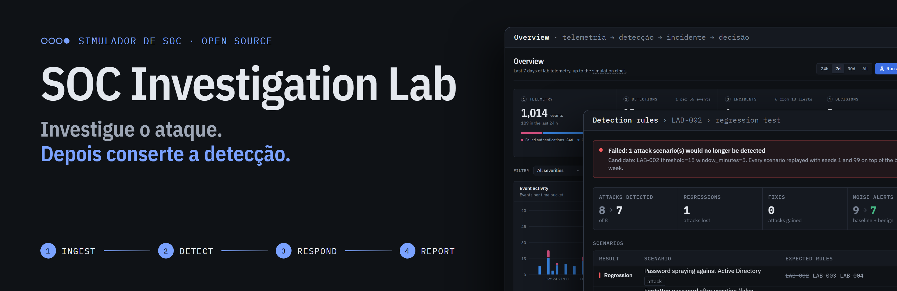
</p>

<p align="center">
  <b>O simulador de SOC em que você investiga o ataque e conserta a detecção.</b><br>
  Laboratório open source para analistas SOC N1/N2: do log bruto ao incidente documentado e de volta à regra,<br> com prova de que nenhum ataque escapou.
</p>

<p align="center">
  <a href="https://github.com/orleans-samai/soc-investigation-lab/actions/workflows/ci.yml"></a>
  <a href="https://github.com/orleans-samai/soc-investigation-lab/releases/latest"></a>
  <a href="LICENSE"></a>
  
  
  
  
</p>

<p align="center">
  <a href="https://github.com/orleans-samai/soc-investigation-lab/releases/latest"></a>
  <a href="https://github.com/orleans-samai/soc-investigation-lab/releases/latest"></a>
</p>

<p align="center">
  <a href="#por-que-é-diferente">Diferenciais</a> ·
  <a href="#o-que-dá-para-fazer">Funcionalidades</a> ·
  <a href="#download-e-instalação">Download</a> ·
  <a href="#rodar-a-partir-do-código">Rodar do código</a> ·
  <a href="#roteiro-de-demonstração">Demonstração</a> ·
  <a href="#arquitetura">Arquitetura</a>
</p>

---

## Em 30 segundos

- **O que é:** um SOC completo em miniatura. Logs Windows, Sysmon, Linux e de aplicação viram eventos normalizados, um motor de detecção em Python gera alertas mapeados ao **MITRE ATT&CK**, alertas viram incidentes e cada investigação termina em uma decisão documentada e em um relatório.
- **Para quem:** quem estuda para SOC N1/N2, quem ensina blue team e quem quer praticar **engenharia de detecção** sem montar um SIEM.
- **Como rodar:** baixe o instalador para Windows ou Linux e abra. Sem conta, sem nuvem, sem chave de API, funciona offline.
- **Dados:** 100% sintéticos (empresa fictícia *Lab Corp*, IPs das faixas de documentação RFC 5737). Nada sai da sua máquina.

## Por que é diferente

A maioria dos laboratórios de SOC para na investigação: você responde perguntas sobre um ataque pronto. Aqui o ciclo fecha do lado da detecção, como num time *purple team*: você investiga, ajusta a regra e **prova** que o ajuste não abriu um buraco.

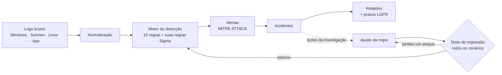

### 1. Teste de regressão de detecção

Antes de salvar um ajuste, o lab reexecuta **todos os cenários** com a regra atual e com a proposta e mostra o antes e depois: quantos ataques continuam detectados, quanto ruído saiu e qual cenário quebrou. É o "rodar a suíte de testes antes do merge" aplicado a regras de SIEM.

<p align="center">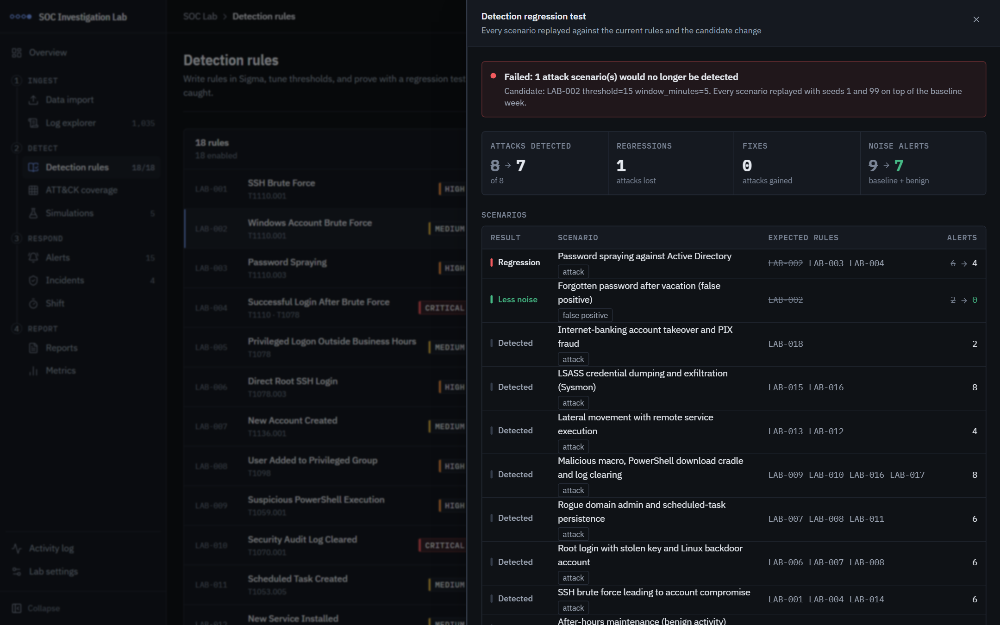</p>
<p align="center"><sub>Subir o limiar da força bruta de 6 para 15 tira o falso positivo da senha esquecida, mas o <i>password spraying</i> deixa de ser detectado. O ajuste é reprovado.</sub></p>

### 2. Modo plantão

Uma fila cronometrada mistura ataques reais, atividade autorizada e falsos positivos, como numa segunda-feira de SOC. Cada alerta pede **veredito e justificativa**. A nota pesa acurácia (60%), SLA por severidade (20%) e notas verificáveis (20%), e um ataque fechado como ruído zera aquele alerta. Treina contra o que mais derruba SOCs de verdade: a **fadiga de alertas**.

<table>
  <tr>
    <td width="50%" valign="top">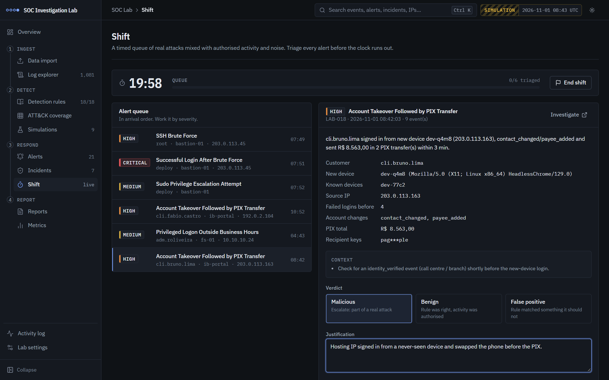</td>
    <td width="50%" valign="top">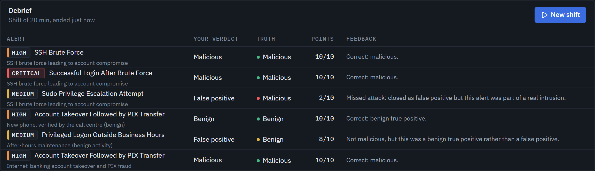</td>
  </tr>
  <tr>
    <td align="center"><sub>A fila ao vivo: severidade, entidade e o relógio correndo</sub></td>
    <td align="center"><sub>O debriefing revela a verdade e explica cada ponto perdido</sub></td>
  </tr>
</table>

### 3. Regras Sigma escritas por você

Escreva ou cole uma regra [Sigma](https://sigmahq.io), incluindo correlações `event_count` e `value_count`, valide com *dry-run* nos eventos do lab e coloque no motor ao lado das 18 regras nativas. A regra ganha limiares ajustáveis, entra no teste de regressão e exporta de volta para qualquer SIEM. As regras nativas também saem em Sigma.

### 4. Cenários a partir de logs reais

Selecione eventos com uma consulta no Log Explorer e salve como cenário de treino reexecutável. O lab **anonimiza** contas, hosts e IPs (inclusive no texto bruto), calcula o gabarito rodando o próprio motor e exporta em JSON para compartilhar com a turma ou o time.

<table>
  <tr>
    <td width="50%" valign="top">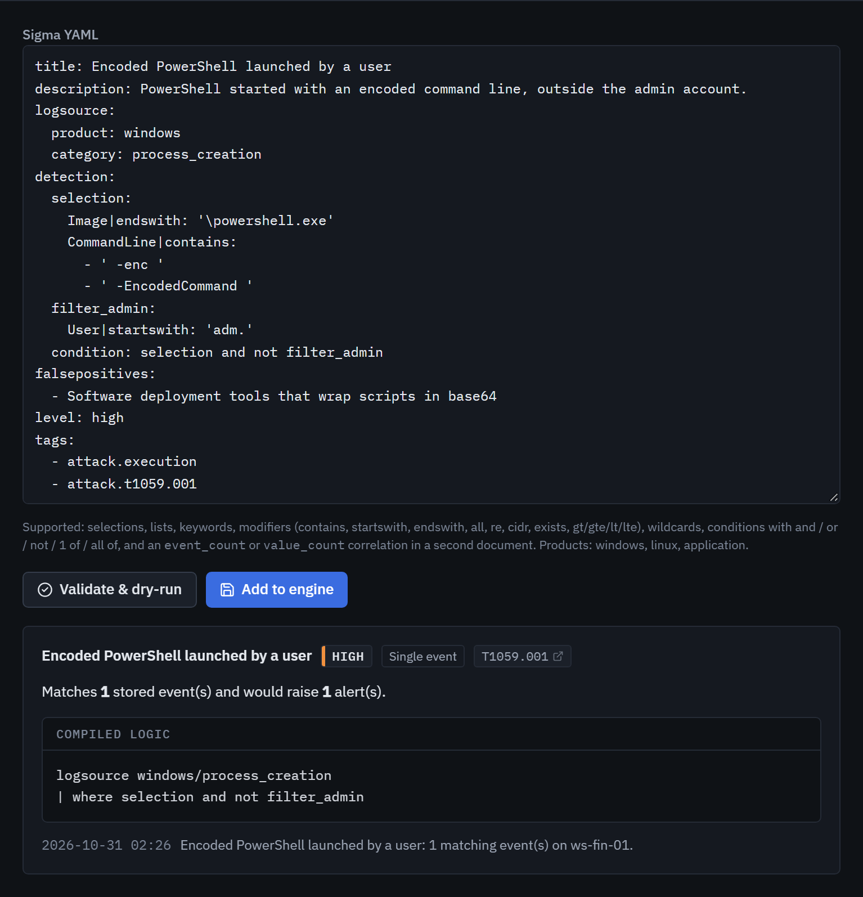</td>
    <td width="50%" valign="top">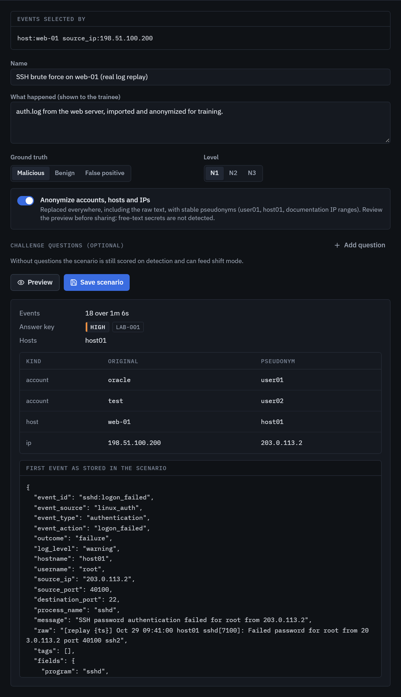</td>
  </tr>
  <tr>
    <td align="center"><sub>Sigma validada nos eventos antes de entrar no motor</sub></td>
    <td align="center"><sub>Um auth.log real vira cenário anonimizado com gabarito</sub></td>
  </tr>
</table>

### 5. Contexto brasileiro

- **Golpe do PIX no log do internet banking:** a regra LAB-018 correlaciona login de dispositivo nunca visto, troca do telefone, favorecido novo e transferências PIX em poucos minutos. Há também o caso benigno: troca de celular confirmada pela central.
- **LGPD no relatório:** marque que houve dados pessoais afetados e o relatório calcula os prazos de comunicação à ANPD e aos titulares (3 dias úteis) e de complementação (20 dias úteis), conforme a Resolução CD/ANPD nº 15/2024.

<table>
  <tr>
    <td width="50%" valign="top">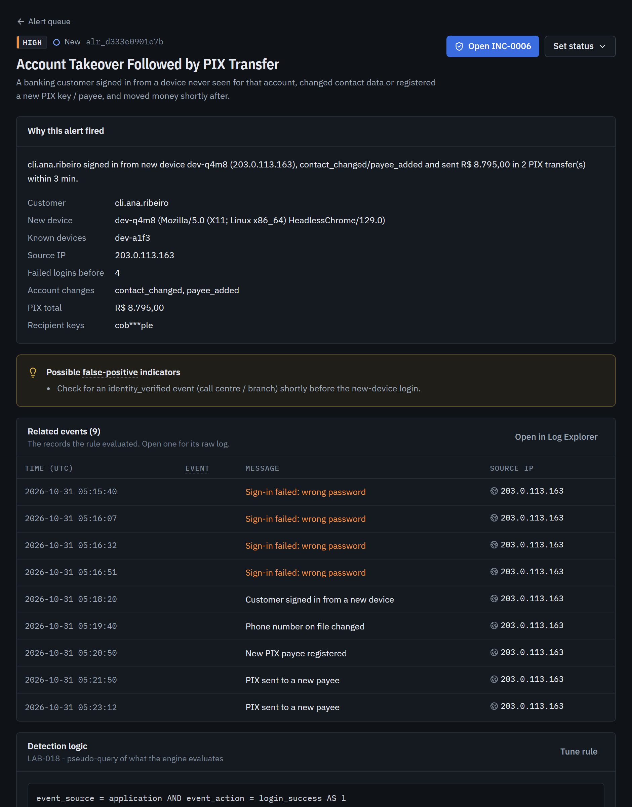</td>
    <td width="50%" valign="top">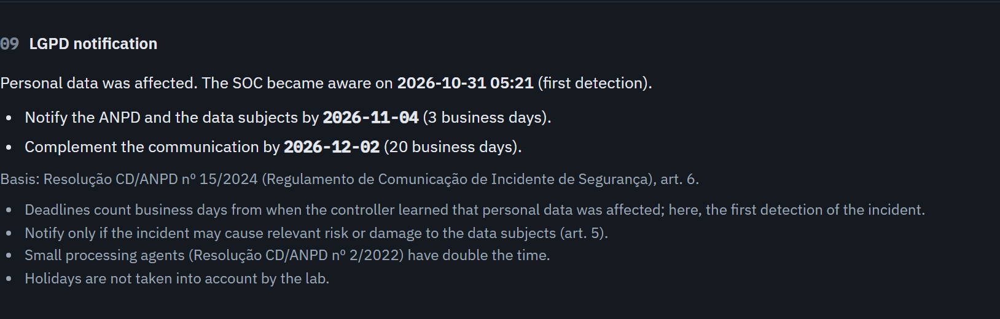</td>
  </tr>
  <tr>
    <td align="center"><sub>Dispositivo novo, telefone trocado e R$ 8,7 mil em 2 PIX</sub></td>
    <td align="center"><sub>Prazos da ANPD calculados a partir da primeira detecção</sub></td>
  </tr>
</table>

## O que dá para fazer

| Módulo | Destaques |
|---|---|
| **Overview** | A cadeia telemetria → detecção → incidente → decisão com conversões entre etapas, o que precisa de atenção, últimas detecções, hosts e origens. Filtros por período, severidade, host e status. |
| **Log Explorer** | Filtros combináveis **ou linguagem de consulta** no estilo KQL/SPL (`outcome:failure host:bastion-01 \| stats count by source_ip \| head 10`) com drill-down nas agregações. Visão normalizada e bruta, exportação CSV/JSON e "salvar como cenário". |
| **Importação** | Windows (JSON/NDJSON, incluindo **Sysmon** 1/3/10/11/22), Linux `auth.log` (syslog clássico e RFC 3339) e formato normalizado. Validação antes de gravar, erros por linha e deduplicação por hash. |
| **Motor de detecção** | 18 regras testadas: força bruta SSH/Windows, password spraying, login após força bruta, logon privilegiado fora do horário, root via SSH, criação de conta, grupo privilegiado, PowerShell suspeito, limpeza de log, tarefa agendada, serviço novo, movimento lateral, abuso de sudo, **acesso ao LSASS**, **Office abrindo shell**, **threat intel** e **tomada de conta com PIX**. Backtest, regressão, Sigma próprio e exportação Sigma. |
| **Threat intelligence** | Feed local e offline de indicadores (IP, domínio, URL, SHA256) consultado pelo motor. |
| **Simulações** | 11 cenários (8 ataques, 3 de ruído) que geram logs brutos, passam pelos parsers reais e validam se as regras esperadas dispararam. |
| **Modo desafio** | Perguntas de investigação verificadas no servidor, com dicas que custam metade dos pontos e gabarito comentado depois do envio. |
| **Modo plantão** | Fila cronometrada, veredito e justificativa por alerta, nota por acurácia, SLA e documentação, e debriefing. |
| **Alertas e incidentes** | Triagem, indícios de falso positivo, correlação automática, timeline, perfis de usuário/host/IP, notas, playbook e encerramento só com classificação e justificativa. |
| **MITRE ATT&CK** | Matriz de cobertura: técnicas cobertas por regra, observadas em alertas e lacunas. |
| **Relatórios** | Resumo executivo, escopo, detecções, ATT&CK, timeline, IOCs, evidências brutas, recomendações e avaliação LGPD. Exporta Markdown/JSON e imprime em PDF. |
| **Métricas** | Precisão, taxa de falso positivo, MTTD, MTTA, MTTR, desempenho por regra, cobertura de cenários, desafios, plantões e último teste de regressão. |

<details>
<summary><b>Mais telas</b> (investigação, linguagem de consulta, desafio, ATT&CK, relatório)</summary>

<br>

<table>
  <tr>
    <td width="50%" valign="top"></td>
    <td width="50%" valign="top">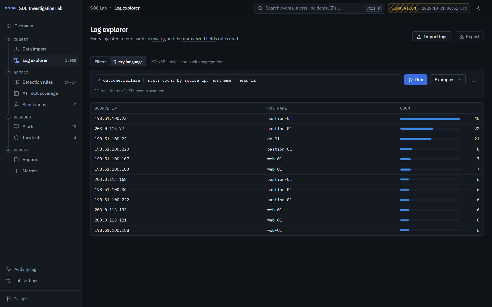</td>
  </tr>
  <tr>
    <td align="center"><sub>Incidente: timeline, entidades e ATT&amp;CK</sub></td>
    <td align="center"><sub>Linguagem de consulta com agregações e drill-down</sub></td>
  </tr>
  <tr>
    <td valign="top"></td>
    <td valign="top">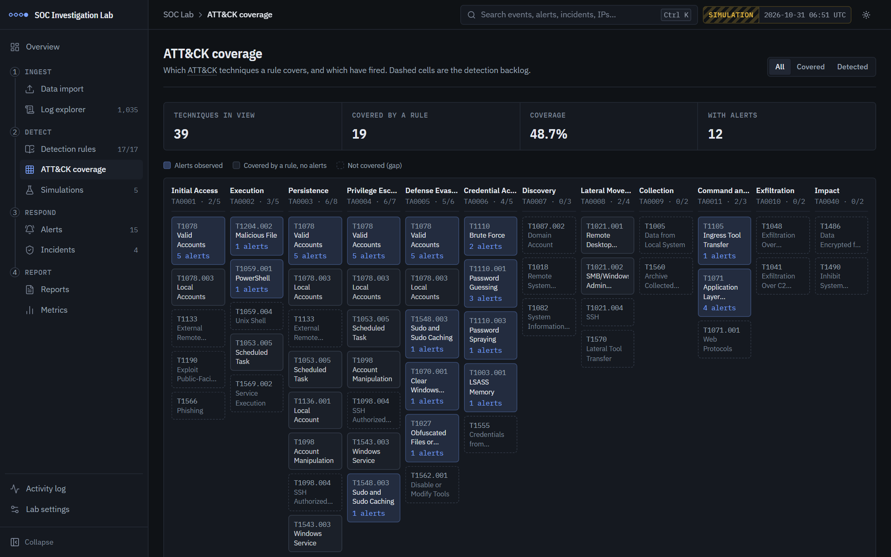</td>
  </tr>
  <tr>
    <td align="center"><sub>Modo desafio: respostas verificadas e pontuação</sub></td>
    <td align="center"><sub>Cobertura MITRE ATT&amp;CK por regra e por alerta</sub></td>
  </tr>
  <tr>
    <td valign="top">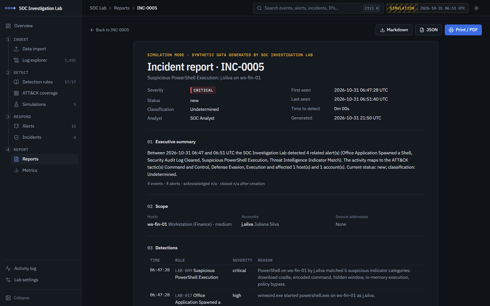</td>
    <td valign="top">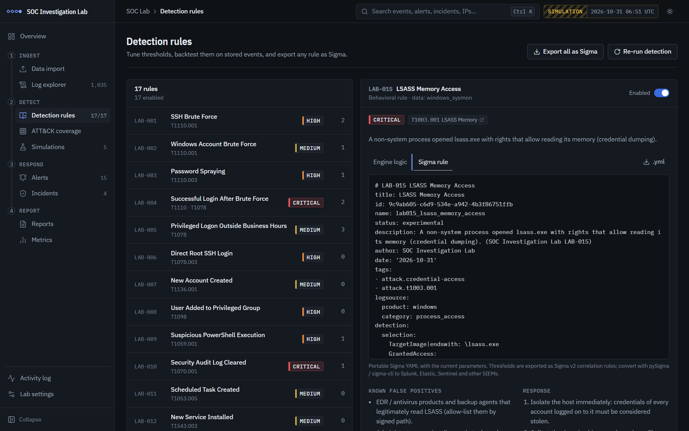</td>
  </tr>
  <tr>
    <td align="center"><sub>Relatório técnico pronto para PDF</sub></td>
    <td align="center"><sub>Regras nativas exportadas em Sigma</sub></td>
  </tr>
</table>

<p align="center"></p>

</details>

## Download e instalação

Baixe o instalador na página de **[Releases](https://github.com/orleans-samai/soc-investigation-lab/releases/latest)**. Não precisa de Python, Node.js, Docker nem internet.

| Sistema | Arquivo | Como instalar |
|---|---|---|
| Windows 10/11 (64 bits) | `SOC-Investigation-Lab-Setup-<versão>.exe` | Execute o instalador (por usuário, sem administrador). |
| Debian, Ubuntu, Mint | `SOC-Investigation-Lab-<versão>-amd64.deb` | `sudo apt install ./SOC-Investigation-Lab-*.deb` |
| Linux (qualquer distro) | `SOC-Investigation-Lab-<versão>-x86_64.AppImage` | `chmod +x SOC-Investigation-Lab-*.AppImage` e execute |

> [!NOTE]
> Os instaladores não têm assinatura de código. No Windows o SmartScreen pode mostrar "O Windows protegeu o computador":
> clique em **Mais informações → Executar assim mesmo**. No Ubuntu 24.04+, se o AppImage não abrir por causa do sandbox do
> Chromium, prefira o `.deb`.

Os dados do lab ficam na pasta do usuário (`%APPDATA%\SOC Investigation Lab` no Windows, `~/.config/SOC Investigation Lab` no Linux), nunca na pasta de instalação. O servidor interno escuta apenas em `127.0.0.1`.

## Rodar a partir do código

<details open>
<summary><b>Com Docker</b></summary>

```bash
cp .env.example .env
docker compose up --build
```

Interface em <http://localhost:3000> e API documentada em <http://localhost:8000/docs>.

</details>

<details>
<summary><b>Localmente</b> (Python 3.12+ e Node.js 20+)</summary>

```bash
cd backend
python -m venv .venv
.venv/bin/pip install -r requirements-dev.txt          # Windows: .venv\Scripts\pip
.venv/bin/uvicorn app.main:app --reload --port 8000
```

Em outro terminal:

```bash
cd frontend
npm install
npm run dev
```

Na primeira execução o backend carrega uma semana de atividade normal da *Lab Corp* e roda o motor de detecção. Para voltar ao estado inicial use **Lab settings → Reset lab** (suas regras Sigma e cenários próprios são mantidos).

</details>

<details>
<summary><b>Gerar os instaladores desktop</b></summary>

O app desktop é um shell **Electron** que inicia o backend empacotado com **PyInstaller**; o backend serve a interface Next.js exportada como arquivos estáticos, numa única origem em `127.0.0.1`.

```bash
cd desktop
npm install
npm run dist          # instalador do sistema atual em desktop/release/
```

O PyInstaller não faz compilação cruzada. O workflow [`release.yml`](.github/workflows/release.yml) compila em Windows e Linux em paralelo, testa o servidor empacotado e publica a Release quando uma tag `v*` é enviada:

```bash
git tag v1.0.1
git push origin v1.0.1
```

</details>

## Roteiro de demonstração

**Em 3 minutos, o diferencial:**

1. **Detection rules → LAB-002:** suba o limiar de 6 para 15 e clique em *Regression test*. O ruído da senha esquecida some, mas o teste **reprova** porque o *password spraying* deixa de ser detectado.
2. **Shift:** comece um plantão de 10 minutos e mostre o debriefing: o ataque fechado como ruído zera aquele alerta.
3. **Simulations → Internet-banking account takeover and PIX fraud:** investigue, marque *dados pessoais afetados* no incidente e mostre o prazo da ANPD no relatório.

<details>
<summary><b>Roteiro completo</b> (5 a 8 minutos)</summary>

1. **Overview:** explique o *Simulation Mode*, o relógio simulado e a cadeia de sinal.
2. **Simulations → "Malicious macro, PowerShell download cradle":** rode o cenário e mostre o pipeline *logs brutos → eventos → alertas → incidente* e a validação das regras esperadas.
3. **Incidente:** percorra a timeline, abra o evento bruto, veja o PowerShell decodificado, consulte os perfis de usuário e host, registre uma nota e encerre como *true positive* com justificativa.
4. **Relatório:** IOCs extraídos, mapeamento ATT&CK e exportação em Markdown/PDF.
5. **Modo desafio:** rode *LSASS credential dumping (Sysmon)* e responda às perguntas usando o Log Explorer.
6. **Linguagem de consulta:** `outcome:failure | stats count by source_ip, hostname` e clique numa linha para o drill-down.
7. **Falso positivo:** rode *After-hours maintenance*, mostre o indício "Inside approved change CHG-xxxx" e feche como benigno.
8. **Sigma:** clique em *New Sigma rule*, valide o modelo e coloque no motor; depois rode o *Regression suite*.
9. **Data import:** importe `samples/malformed_sample.log` e mostre os erros por linha; importe de novo e mostre a deduplicação.

</details>

## Arquitetura

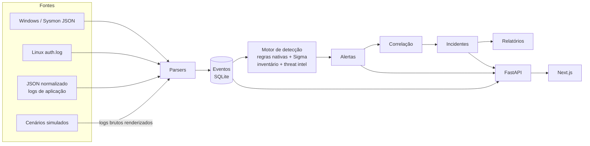

| Camada | Tecnologia |
|---|---|
| Backend | Python 3.12, FastAPI, Pydantic v2, PyYAML (Sigma), Pytest, Ruff. OpenAPI em `/docs` |
| Frontend | Next.js 15 (App Router), React 19, TypeScript, Tailwind CSS 4, Radix, Recharts, Motion, SWR, IBM Plex |
| Persistência | SQLite com WAL e gravação incremental (ou JSON com escrita atômica); migração e quarentena automáticas |
| Desktop | Electron + PyInstaller: instalador NSIS (Windows), AppImage e .deb (Linux) |
| Qualidade | GitHub Actions: lint, 175 testes de backend, build, typecheck, 9 testes e2e com Playwright e imagens Docker |

Mais detalhes em [docs/ARCHITECTURE.md](docs/ARCHITECTURE.md), o sistema visual em [docs/DESIGN-SYSTEM.md](docs/DESIGN-SYSTEM.md) e a documentação de cada regra em [docs/DETECTION_RULES.md](docs/DETECTION_RULES.md).

<details>
<summary><b>Decisões técnicas</b></summary>

- **IDs determinísticos:** eventos usam `sha256(origem + raw)` e alertas usam `regra | chave | primeiro evento`. Reimportar ou reexecutar a detecção nunca duplica dados e preserva o trabalho do analista.
- **Simulação pelo caminho real:** cenários geram texto bruto que passa pelos mesmos parsers da importação, então cada simulação também testa a ingestão.
- **Regressão sem efeito colateral:** o teste roda os cenários com sementes fixas sobre a semana de baseline, em memória; nada é gravado no lab, e só as regras alteradas são reexecutadas para a proposta.
- **Sigma vira regra de verdade:** a regra compilada herda da mesma classe das nativas, então ganha ajuste, backtest, regressão e exportação sem código especial.
- **Contexto antes de severidade:** inventário de ativos e identidades e janelas de mudança alimentam severidade dinâmica e indícios de falso positivo.
- **Decisão documentada:** incidentes só fecham com classificação e justificativa; a precisão nas métricas vem dessas decisões.
- **Segurança:** limites de upload, rejeição de binários, nenhum conteúdo executado, proteção contra *CSV injection*, containers sem root e portas só em `127.0.0.1`.

</details>

<details>
<summary><b>Estrutura do repositório</b></summary>

```
backend/
  app/
    api/          rotas FastAPI (eventos, detecção, investigação, plantão)
    detection/    regras nativas, compilador Sigma, motor, inventário, ATT&CK, threat intel
    models/       modelos Pydantic (contrato da API e esquema persistido)
    parsers/      Windows/Sysmon JSON, Linux auth.log, normalizado
    services/     orquestração, regressão, plantão, autoria de cenários, consultas, relatórios
    simulation/   renderização de cenários e gerador do baseline
    storage/      SQLite/JSON e repositórios
  data/           seed, cenários, inventário, ATT&CK, threat intel
  tests/
frontend/
  src/app/        páginas (overview, events, rules, simulations, shift, alerts, incidents, reports, metrics...)
  src/components/ shell, componentes de UI e de investigação
  e2e/            testes Playwright
desktop/          app Electron e build dos instaladores
docs/             arquitetura, design system, regras e capturas de tela
marketing/        templates das imagens de divulgação
samples/          arquivos para importar
```

</details>

## Testes

```bash
cd backend && .venv/bin/pytest            # 175 testes: parsers, regras, cenários, Sigma, regressão, plantão, autoria, SQLite e API
cd backend && .venv/bin/ruff check .
cd frontend && npm run lint && npm run typecheck && npm run build
cd frontend && NEXT_OUTPUT=export npm run build:export && npx playwright install chromium && npm run test:e2e
```

`tests/test_scenarios.py` funciona como validação de detecção: cada cenário, com duas sementes, precisa disparar **exatamente** as regras para as quais foi desenhado, e o conjunto de cenários precisa cobrir todas as regras. Os testes Playwright sobem o lab do zero como o app desktop e percorrem o fluxo do analista, do Overview ao plantão pontuado.

As capturas deste README são geradas a partir do app real: `node scripts/screenshots.mjs` e `node scripts/linkedin-assets.mjs` em `frontend/`.

<details>
<summary><b>Arquivos de exemplo</b> para importar</summary>

Em [`samples/`](samples), também disponíveis na tela de importação:

| Arquivo | Conteúdo |
|---|---|
| `windows_security_sample.json` | Rajada de 4625 seguida de 4624 a partir de IP externo (LAB-002 e LAB-004) |
| `linux_auth_sample.log` | Força bruta SSH em syslog clássico e sudo negado (use ano 2026, fuso UTC) |
| `normalized_sample.json` | Eventos no esquema interno, com um registro inválido proposital |
| `sysmon_sample.json` | Acesso ao LSASS por binário suspeito (LAB-015) e por antivírus (ignorado), DNS para domínio de phishing (LAB-016) |
| `malformed_sample.log` | Linhas válidas e inválidas misturadas para demonstrar o relatório de erros |

</details>

## Limitações

- Laboratório local de usuário único, sem autenticação. Não exponha na rede.
- O motor reavalia todos os eventos a cada ingestão: bom para centenas de milhares de eventos; volumes maiores pediriam detecção incremental e PostgreSQL atrás do mesmo repositório.
- O subconjunto Sigma cobre o uso do dia a dia; correlações temporais, modificadores `base64`/`windash` e agregações com pipe são recusados com mensagem clara.
- A anonimização troca contas, hosts e IPs, mas não detecta segredos em texto livre: revise a prévia antes de compartilhar.
- Os prazos da LGPD contam dias úteis de segunda a sexta, sem feriados, e são uma referência didática, não orientação jurídica.

Próximos passos possíveis: interface em português, logs de proxy e firewall, ranking de turma no modo plantão e modo multiusuário.

---

<p align="center">
  <sub>Projeto educacional sob a <a href="LICENSE">licença MIT</a>. Todos os nomes, hosts, contas e endereços são fictícios.</sub>
</p>
