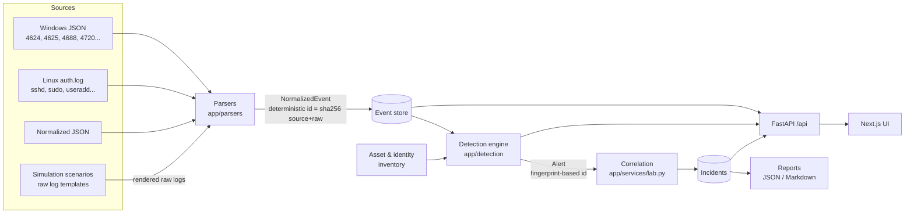
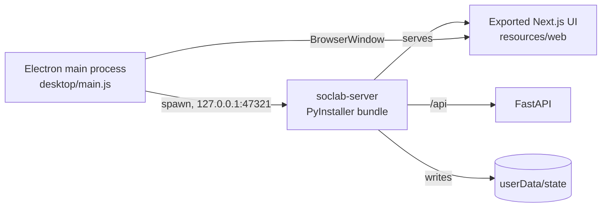

# Architecture

## Data flow

1. **Ingestion** - files (`POST /api/imports`) and simulations both end up as raw text that goes through the *same* parsers.
   Parsers only use regular expressions and `json.loads`; nothing in a file is ever evaluated or executed.
2. **Normalization** - every source maps to `NormalizedEvent` (`backend/app/models/events.py`). The raw record is preserved
   verbatim. The event id is `sha256(source + raw)`, so re-importing the same file cannot create duplicates.
3. **Detection** - `DetectionEngine.run(events, config)` evaluates every enabled rule over the time-sorted events. Rules are
   stateless and return `AlertDraft`s; the engine turns them into `Alert`s whose id is derived from
   `rule_id | group key | first event id`. Re-running detection therefore *updates* an alert when its burst grows instead of
   duplicating it, and analyst state (status, notes) is kept.
4. **Correlation** - new alerts join an open incident when they share an account or source IP within 2 h, or the same host
   within 20 min. High/critical alerts open incidents automatically; medium/low alerts wait in the triage queue (or join an
   incident that already exists), which mirrors a real N1 workflow.
5. **Investigation & reporting** - incidents carry entities, ATT&CK techniques, notes, classification and resolution. Closing
   requires both a classification and a written resolution. Reports are generated on demand from the stored state.

## Backend layout

| Path | Responsibility |
|---|---|
| `app/models/` | Pydantic models - the API contract and the persisted schema |
| `app/parsers/` | Windows JSON, Linux auth.log and normalized parsers + format detection |
| `app/detection/` | Rule base classes, the 14 rules, the engine, inventory and MITRE catalog |
| `app/simulation/` | Scenario rendering and the deterministic baseline generator |
| `app/services/` | Orchestration (`lab.py`), queries, analytics, entities, reports, ingestion |
| `app/storage/` | Atomic JSON persistence and in-memory repositories |
| `app/api/` | FastAPI routers (OpenAPI at `/docs`) |
| `data/` | Read-only reference data: seed events, scenarios, inventory, ATT&CK subset |

## Persistence

* One JSON file per collection under `SOCLAB_STATE_DIR` with an envelope (`schema_version`, `collection`, `meta`, `items`).
* Writes use *temp file -> fsync -> `os.replace`*, so a crash leaves either the old or the new file, never a torn one.
* On load, unreadable files are quarantined (`*.corrupt-<ts>.json`) and invalid records are skipped and counted; the
  status endpoint reports recovered collections.
* All mutations go through `LabService` while holding one re-entrant lock.
* Services only use `LabStore`/`Collection` methods (`get`, `all`, `upsert`, `persist`), so a SQLite/PostgreSQL implementation
  can replace `app/storage/repository.py` without touching the rest of the code.

## Time model

All timestamps are stored and displayed in UTC. The **simulation clock** is the timestamp of the most recent event; dashboard
ranges ("last 24h") are relative to it, so the seed dataset always looks "live". Business-hours rules evaluate local time in
`SOCLAB_LAB_TIMEZONE` (default `America/Sao_Paulo`). Classic syslog lines (no year, no offset) are interpreted with the year and
timezone chosen at import, with year-rollover protection.

## Frontend

Next.js App Router (all pages are client components fed by SWR). The Next server proxies `/api/*` to FastAPI, so the browser
talks to a single origin. Design tokens live in `src/app/globals.css` (dark theme first, light theme mirrored); severity colours
are reserved for severity, and chart colours were validated for colour-vision deficiency in both themes.

## Desktop distribution

* `NEXT_OUTPUT=export` builds the UI as static files; detail pages use `?id=` so no Node.js server is needed.
* `backend/soclab_server.py` is the bundle's entry point: it picks a free port, prints `SOCLAB_LISTENING <url>`, and runs
  uvicorn with `SOCLAB_STATIC_DIR` mounted at `/` (after `/api` and `/docs`).
* Electron waits for `/api/health`, then loads the URL. External links open in the system browser; the server is killed
  when the app quits. Lab state lives in the per-user data folder, never in the install directory.
* `.github/workflows/release.yml` builds on `windows-latest` and `ubuntu-latest` (PyInstaller cannot cross-compile),
  smoke-tests the bundled server, and attaches the NSIS installer, AppImage and .deb to a GitHub Release.

## Security considerations

* Uploads: size limit, line limit, UTF-8 only, NUL-byte rejection, per-line errors, no execution of content.
* CSV export neutralises spreadsheet formula injection (`=`, `+`, `-`, `@` prefixes).
* PowerShell `-EncodedCommand` payloads are decoded *as text* for the analyst, never run.
* Destructive operations (lab reset) require an explicit confirmation token and a confirmation dialog.
* Containers run as non-root users; ports are bound to `127.0.0.1` in Compose.
* No authentication: the MVP is a single-user local lab. Do not expose it to a network.
